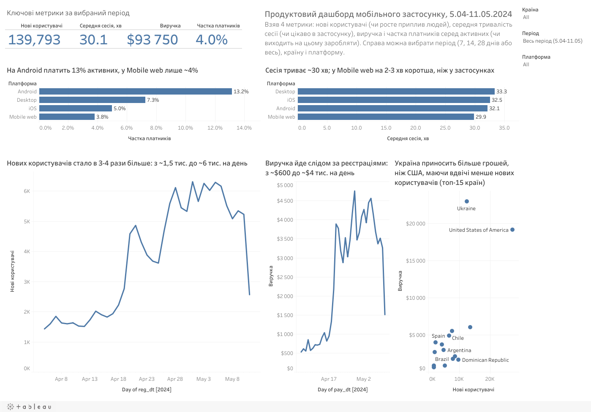

# МІПА. Лабораторна робота №3: візуалізація даних у Tableau

Дашборд продуктових метрик мобільного застосунку (Acquisition, Engagement, Monetization).

Опублікований дашборд: https://public.tableau.com/app/profile/nazar.beldiaha/viz/MIPALab3-MobileAppProductDashboard/Dashboard1

- `data/` - csv-файли, на яких побудовано дашборд (registrations, sessions, payments, country_info_dict)
- `MIPALab3-MobileAppProductDashboard.twbx` - резервна копія воркбука Tableau з вшитими даними
- `screenshots/` - скрін дашборду

Бельдяга Назар, ІП-31
